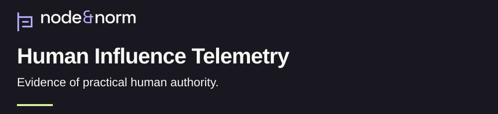
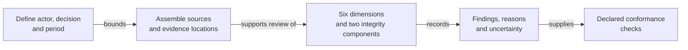

<h1>
<picture>
  <source media="(max-width: 600px)" srcset="assets/research/v1/banner-mobile-dark.svg">
  
</picture>
</h1>

[](docs/closeout-plan.md) [](https://github.com/node-and-norm/human-influence-telemetry/releases/tag/v0.6.7) [](LICENSE)

What records show that human judgment affected a consequential decision? Human Influence Telemetry (HIT) organizes evidence about a named person's authority, its exercise and its limits. [Research question and contribution](docs/research-summary.md).

[Policy reader: understand in 90 seconds](#research-in-90-seconds) · [Reviewer: inspect the evidence](docs/current-review.md) · [Engineer: run the checks](docs/reference-verification.md)

## At a glance

| | Current account |
| :--- | :--- |
| Purpose | Assess documentary evidence of practical human authority. [Specification](SPECIFICATION.md) |
| Status | Maintenance since October 17, 2026. Manuscript approval and independent validation retain separate requirements. [Closeout](docs/closeout-plan.md) |
| Evidence type | One preserved human scoring exercise; documentary development cases; separate AI and synthetic experiments. [Review guide](docs/current-review.md#evidence-to-read) |
| Version | 0.6.7, released October 8, 2026. Later repository records sit outside that archive. [Publication receipt](release/v0.6.7/publication-receipt.json) |
| License | [Apache-2.0](LICENSE) |
| Cite | [Software DOI: 10.5281/zenodo.23252877](https://doi.org/10.5281/zenodo.23252877) · [citation metadata](CITATION.cff) |

Two eligible independent scorers reached **7 of 7 exact agreements** on one frozen Cigna packet under the earlier 0.1.0 contract. Both used one substantive rating category. The result leaves broader reliability and current-contract replication unresolved. [Results and limits](validation/results/README.md).

## Research in 90 seconds

HIT asks whether observable records distinguish substantive human influence from ceremonial presence in AI-mediated institutional decisions. Its unit of assessment names an actor, a decision, a period and an evidence boundary. [Research account](RESEARCH.md), [application handbook](docs/application-handbook.md).

The method examines six dimensions: access to evidence before a decision (Counsel), evaluation of reasons (Judgment), practical decision authority (Command), reconsideration (Correction), remedy after harm (Repair) and changes to decision arrangements (Reform). Telemetry Integrity separately examines the institutional records and the assembled assessment packet. The [specification](SPECIFICATION.md) defines each threshold and permitted evidence route.

Each finding retains its sources and uncertainty. A value of `0` requires affirmative evidence of absence. A value of `1` records process-specific formal presence; `2` records substantive exercise or qualifying operational capability. `IE` preserves insufficient evidence as its own state. [Finding rules](SPECIFICATION.md), [worked applications](case-studies/README.md).

## Method in brief



The text sequence is: define the boundary, assemble sources, assess the dimensions and integrity, preserve the reasons, then check the record against declared rules. Conformance means the record satisfies those rules. Source interpretation remains a human review responsibility. [Handbook](docs/application-handbook.md), [conformance implementation](src/), [limits](LIMITATIONS.md).

## Evidence and known limits

| Material | What is available | What remains open |
| :--- | :--- | :--- |
| Human result | Two scorers, one frozen Cigna packet and seven agreements under contract 0.1.0. [Preserved comparison](validation/results/README.md) | Cohen's kappa is undefined because substantive ratings have no category variance. Wider reliability and replication under contract 0.4.0 remain open. [Limits](LIMITATIONS.md) |
| Documentary development | Partial applications and a fuller Ofqual draft with bounded author decisions. [Development workbench](research/strengthening/README.md) | Counsel and deferred interpretations retain their recorded status. [Author review](research/strengthening/solo-002-author-review.md), [closeout](docs/closeout-plan.md) |
| Software and publication controls | A declared-rule engine and mapped claim checks. [Conformance fixtures](fixtures/v0.5.0-conformance/README.md), [audit](audits/v0.6.5/audit-report.md) | The audit reports `PASS_WITH_EXCEPTIONS`. Source truth, institutional effectiveness and independent implementation review remain separate questions. [Verification limits](docs/research-integrity-verification.md) |
| AI and synthetic experiments | Saved model responses and a rehearsal with four injected evidence changes. [Passage results](research/strengthening/passage-report.md), [rehearsal](research/strengthening/evidence-update-001/report.md) | Authored references and highly cued inputs limit inference. Human benefit and comparative superiority remain unmeasured. [Evaluation scope](research/strengthening/evaluation-methods.md) |
| Source reading | November 3 personal reading receipts and a bounded later-draft reuse decision. [Source-review record](paper/source-checks-ofqual-related-work-2026-10-17.md) | SR-05 remains partial. Whole-manuscript review and adoption of proposed corrections remain separate. [Current review guide](docs/current-review.md#personal-source-review) |

The working manuscript remains a methods/resource draft. Its current text lacks whole-draft approval, and submission is deferred. The literature review and broader validity questions remain open. [Manuscript status](docs/closeout-plan.md#publish-a-paper), [known limits](LIMITATIONS.md).

## Reproduce the checks

Use Python 3.12 and a full Git clone. The [verification guide](docs/reference-verification.md) supplies exact commands, expected outcomes and write effects. It starts with the conformance engine and byte-integrity checks, then points to the complete [continuous integration workflow](.github/workflows/validate.yml).

## AI assistance and human review

Codex assisted source retrieval, implementation, proposed interpretations, critique and manuscript prose. Jev supplied separately recorded model outputs. The working draft requires the responsible author to verify substantive claims and approve the exact text before publication or submission. [Project disclosure](paper/development-manuscript.md#7-declarations-and-conclusion), [development records](research/strengthening/README.md).

The preserved independent scoring exercise, author decisions and selected personal source readings have distinct scopes. The November 3 decision permits bounded use of corrections in a later draft while preserving the manuscripts. [Human-result record](validation/results/README.md), [source-review receipts](paper/source-checks-ofqual-related-work-2026-10-17.md), [program disclosure](https://nodeandnorm.org/about/research-integrity/#ai-use).

## Citation

The following citation preserves the current software identity in [CITATION.cff](CITATION.cff).

> Banasihan, M. J. (2026). *Human Influence Telemetry* (Version 0.6.7) [Software]. Zenodo. [https://doi.org/10.5281/zenodo.23252877](https://doi.org/10.5281/zenodo.23252877)

Cite the version used. For changes after an archived release, also record the exact commit. The [citation guide](docs/citation.md) distinguishes earlier releases, the evolving project and the originating research record.

## BibTeX

The entry renders the same software identity in [CITATION.cff](CITATION.cff).

```bibtex
@software{banasihan2026hit,
  author = {Banasihan, Mark Julius},
  title = {Human Influence Telemetry},
  version = {0.6.7},
  date = {2026-10-08},
  year = {2026},
  doi = {10.5281/zenodo.23252877},
  url = {https://github.com/node-and-norm/human-influence-telemetry}
}
```

<details>
<summary>Release identities and future gates</summary>

**Current release:** 0.6.7. [Publication receipt](release/v0.6.7/publication-receipt.json).

**Current exact-version DOI:** `10.5281/zenodo.23252877`. [Archived software](https://doi.org/10.5281/zenodo.23252877).

**Human-result release:** 0.6.0. [Preserved results](validation/results/README.md).

**Conformance engine version:** 0.5.0. [Engine contract](fixtures/v0.5.0-conformance/README.md).

**Current maturity:** Level 2, Applicable. [Recorded decision](docs/decisions/ADR-0004-advance-hit-to-maturity-level-2.md).

The normative assessment contract remains 0.4.0. [Specification](SPECIFICATION.md).

**Stable target:** `1.0.0`, release prohibited. All eight stable gates remain unresolved. [Gate register](release/v1.0.0/gate-register.json).

**Active replication protocol:** `HIT-IRP-HIT040-002`, candidate, scoring prohibited. [Readiness plan](docs/v1-readiness-plan.md).

Candidate and future-version documents in the repository are planning and release-control artifacts. They are not published releases. [Release index](docs/releases/README.md).

</details>

<details>
<summary>Complete prior entry and technical history</summary>

The [complete prior README](README-2026-11-03.md) preserves the entry at [audit commit 22b6a8a](https://github.com/node-and-norm/human-influence-telemetry/tree/22b6a8ad5ea5ef43f1d20c9b63b790cf7294ffbb). It retains the full artifact catalog, development account and reproduction history.

- [Specification](SPECIFICATION.md)
- [Application handbook](docs/application-handbook.md)
- [Working manuscript](paper/development-manuscript.md)
- [Historical manuscript](paper/manuscript.md)
- [Governance](GOVERNANCE.md)
- [Contribution policy](CONTRIBUTING.md)

</details>
